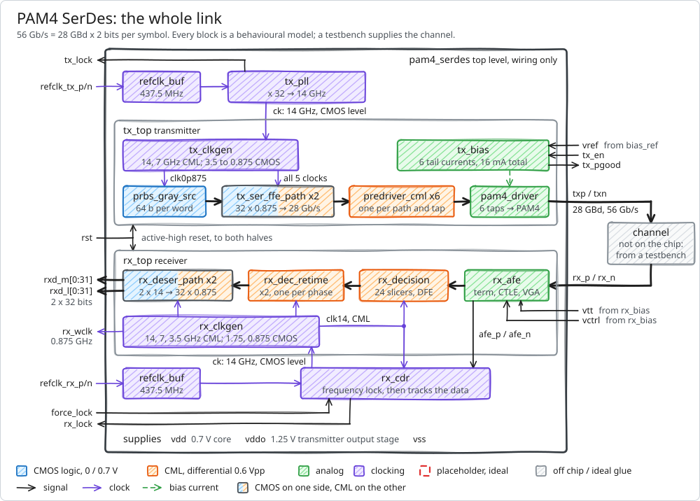

# PAM4 SerDes

A 56 Gb/s PAM4 serializer/deserializer (28 GBd, two bits per symbol), built block by block by the UW ASIC student team. The architecture follows Lee et al., JSSC 2015 ("56 Gb/s NRZ/PAM4").

**Where the project is.** Every block has a behavioural Verilog-A model, and the models are wired into one hierarchy that simulates.

**What comes next.** Topology research for every block (which circuit implements it), then sizing research (device sizes that meet the block's specs). Each block's owner does that work.

If you own a block, your next job is to fill in the **Topology research** section of its page. The table below takes you there.

## Where to read (and write) things

Every block has one Markdown page with the same three sections:

| Section of the page | What is in it | Who writes it |
|---|---|---|
| Architecture | What the block does, where it sits, its ports and parameters, and what the present model leaves out | Already written, from the Verilog-A model. Update it when the model changes |
| Topology research | Requirements, candidate circuits, the chosen one and why, schematic, open questions, references | The block's owner, in this stage. A template is in place |
| Sizing research | Target specs, sizing method, device table, simulation results, corners, open issues | The block's owner, once the topology is chosen. A template is in place |

**The Topology research and Sizing research links are where you read the research and also where the owner writes it.** Each link opens a section of `analog/PAM4SerDes/docs/<Section>/<block>.md`. Edit that file and commit it like any other. Keep its three `##` headings unchanged, because this table links to them.

Owners are taken from the git history (the author of the model file; where a lead committed a file for someone else, the real author is shown). **If a name is wrong, correct it** here, in the section overview and on the block's page.

### Biasing

Section overview: [Biasing](analog/PAM4SerDes/docs/Biasing/README.md)

| Block | Owner (from git history) | Architecture | Topology research | Sizing research |
|---|---|---|---|---|
| tx_bias | Krrish Lala | [read](analog/PAM4SerDes/docs/Biasing/tx_bias.md#architecture) | [read / write](analog/PAM4SerDes/docs/Biasing/tx_bias.md#topology-research) | [read / write](analog/PAM4SerDes/docs/Biasing/tx_bias.md#sizing-research) |

### Clocking

Section overview: [Clocking](analog/PAM4SerDes/docs/Clocking/README.md)

| Block | Owner (from git history) | Architecture | Topology research | Sizing research |
|---|---|---|---|---|
| refclk_buf | Ethan Sun (sunezh) | [read](analog/PAM4SerDes/docs/Clocking/refclk_buf.md#architecture) | [read / write](analog/PAM4SerDes/docs/Clocking/refclk_buf.md#topology-research) | [read / write](analog/PAM4SerDes/docs/Clocking/refclk_buf.md#sizing-research) |
| tx_pll | Ethan Sun (sunezh) | [read](analog/PAM4SerDes/docs/Clocking/tx_pll.md#architecture) | [see its cells](analog/PAM4SerDes/docs/Clocking/tx_pll.md#topology-research) | [see its cells](analog/PAM4SerDes/docs/Clocking/tx_pll.md#sizing-research) |
| pfd | GreenBlueFish | [read](analog/PAM4SerDes/docs/Clocking/pfd.md#architecture) | [read / write](analog/PAM4SerDes/docs/Clocking/pfd.md#topology-research) | [read / write](analog/PAM4SerDes/docs/Clocking/pfd.md#sizing-research) |
| charge_pump | Ethan Sun (sunezh) | [read](analog/PAM4SerDes/docs/Clocking/charge_pump.md#architecture) | [read / write](analog/PAM4SerDes/docs/Clocking/charge_pump.md#topology-research) | [read / write](analog/PAM4SerDes/docs/Clocking/charge_pump.md#sizing-research) |
| loop_filter_rc | Sudhanshu Tiwari | [read](analog/PAM4SerDes/docs/Clocking/loop_filter_rc.md#architecture) | [read / write](analog/PAM4SerDes/docs/Clocking/loop_filter_rc.md#topology-research) | [read / write](analog/PAM4SerDes/docs/Clocking/loop_filter_rc.md#sizing-research) |
| vco | GreenBlueFish | [read](analog/PAM4SerDes/docs/Clocking/vco.md#architecture) | [read / write](analog/PAM4SerDes/docs/Clocking/vco.md#topology-research) | [read / write](analog/PAM4SerDes/docs/Clocking/vco.md#sizing-research) |
| div_n | Ethan Sun (sunezh) | [read](analog/PAM4SerDes/docs/Clocking/div_n.md#architecture) | [read / write](analog/PAM4SerDes/docs/Clocking/div_n.md#topology-research) | [read / write](analog/PAM4SerDes/docs/Clocking/div_n.md#sizing-research) |
| lock_detect | Ethan Sun (sunezh) | [read](analog/PAM4SerDes/docs/Clocking/lock_detect.md#architecture) | [read / write](analog/PAM4SerDes/docs/Clocking/lock_detect.md#topology-research) | [read / write](analog/PAM4SerDes/docs/Clocking/lock_detect.md#sizing-research) |
| tx_clkgen | Ethan Sun (sunezh) | [read](analog/PAM4SerDes/docs/Clocking/tx_clkgen.md#architecture) | [see its cells](analog/PAM4SerDes/docs/Clocking/tx_clkgen.md#topology-research) | [see its cells](analog/PAM4SerDes/docs/Clocking/tx_clkgen.md#sizing-research) |
| rx_clkgen | Ethan Sun (sunezh) | [read](analog/PAM4SerDes/docs/Clocking/rx_clkgen.md#architecture) | [see its cells](analog/PAM4SerDes/docs/Clocking/rx_clkgen.md#topology-research) | [see its cells](analog/PAM4SerDes/docs/Clocking/rx_clkgen.md#sizing-research) |
| dcc_cml | Sudhanshu Tiwari | [read](analog/PAM4SerDes/docs/Clocking/dcc_cml.md#architecture) | [read / write](analog/PAM4SerDes/docs/Clocking/dcc_cml.md#topology-research) | [read / write](analog/PAM4SerDes/docs/Clocking/dcc_cml.md#sizing-research) |
| clkbuf_cml | Ethan Sun (sunezh) | [read](analog/PAM4SerDes/docs/Clocking/clkbuf_cml.md#architecture) | [read / write](analog/PAM4SerDes/docs/Clocking/clkbuf_cml.md#topology-research) | [read / write](analog/PAM4SerDes/docs/Clocking/clkbuf_cml.md#sizing-research) |
| div2_cml | none yet | [read](analog/PAM4SerDes/docs/Clocking/div2_cml.md#architecture) | [read / write](analog/PAM4SerDes/docs/Clocking/div2_cml.md#topology-research) | [read / write](analog/PAM4SerDes/docs/Clocking/div2_cml.md#sizing-research) |
| cml2cmos | Sudhanshu Tiwari | [read](analog/PAM4SerDes/docs/Clocking/cml2cmos.md#architecture) | [read / write](analog/PAM4SerDes/docs/Clocking/cml2cmos.md#topology-research) | [read / write](analog/PAM4SerDes/docs/Clocking/cml2cmos.md#sizing-research) |
| phase_aligner | Winy | [read](analog/PAM4SerDes/docs/Clocking/phase_aligner.md#architecture) | [read / write](analog/PAM4SerDes/docs/Clocking/phase_aligner.md#topology-research) | [read / write](analog/PAM4SerDes/docs/Clocking/phase_aligner.md#sizing-research) |
| div2_tspc | Ethan Sun (sunezh) | [read](analog/PAM4SerDes/docs/Clocking/div2_tspc.md#architecture) | [read / write](analog/PAM4SerDes/docs/Clocking/div2_tspc.md#topology-research) | [read / write](analog/PAM4SerDes/docs/Clocking/div2_tspc.md#sizing-research) |
| rx_cdr | Ethan Sun (sunezh) | [read](analog/PAM4SerDes/docs/Clocking/rx_cdr.md#architecture) | [see its cells](analog/PAM4SerDes/docs/Clocking/rx_cdr.md#topology-research) | [see its cells](analog/PAM4SerDes/docs/Clocking/rx_cdr.md#sizing-research) |
| cdr_pd_linear | Winy | [read](analog/PAM4SerDes/docs/Clocking/cdr_pd_linear.md#architecture) | [read / write](analog/PAM4SerDes/docs/Clocking/cdr_pd_linear.md#topology-research) | [read / write](analog/PAM4SerDes/docs/Clocking/cdr_pd_linear.md#sizing-research) |
| cdr_glue (`qdelay`, `nor2`) | Ethan Sun (sunezh) | [read](analog/PAM4SerDes/docs/Clocking/glue.md#architecture) | [read / write](analog/PAM4SerDes/docs/Clocking/glue.md#topology-research) | [read / write](analog/PAM4SerDes/docs/Clocking/glue.md#sizing-research) |
| diff2se | Ethan Sun (sunezh) | [read](analog/PAM4SerDes/docs/Clocking/glue.md#architecture) | [read / write](analog/PAM4SerDes/docs/Clocking/glue.md#topology-research) | [read / write](analog/PAM4SerDes/docs/Clocking/glue.md#sizing-research) |
| dff_cmos_x32 | Sudhanshu Tiwari | [read](analog/PAM4SerDes/docs/Clocking/dff_cmos_x32.md#architecture) | [read / write](analog/PAM4SerDes/docs/Clocking/dff_cmos_x32.md#topology-research) | [read / write](analog/PAM4SerDes/docs/Clocking/dff_cmos_x32.md#sizing-research) |
| dff_tspc_x8 | Ethan Sun (sunezh) | [read](analog/PAM4SerDes/docs/Clocking/dff_tspc_x8.md#architecture) | [read / write](analog/PAM4SerDes/docs/Clocking/dff_tspc_x8.md#topology-research) | [read / write](analog/PAM4SerDes/docs/Clocking/dff_tspc_x8.md#sizing-research) |
| cml_dff_x4 | Sudhanshu Tiwari | [read](analog/PAM4SerDes/docs/Clocking/cml_dff_x4.md#architecture) | [read / write](analog/PAM4SerDes/docs/Clocking/cml_dff_x4.md#topology-research) | [read / write](analog/PAM4SerDes/docs/Clocking/cml_dff_x4.md#sizing-research) |

### Transmitter

Section overview: [Transmitter](analog/PAM4SerDes/docs/Transmitter/README.md)

| Block | Owner (from git history) | Architecture | Topology research | Sizing research |
|---|---|---|---|---|
| tx_top | Omar El-Sawy (integration) | [read](analog/PAM4SerDes/docs/Transmitter/tx_top.md#architecture) | [see its cells](analog/PAM4SerDes/docs/Transmitter/tx_top.md#topology-research) | [see its cells](analog/PAM4SerDes/docs/Transmitter/tx_top.md#sizing-research) |
| tx_ser_ffe_path | Omar El-Sawy (integration) | [read](analog/PAM4SerDes/docs/Transmitter/tx_ser_ffe_path.md#architecture) | [see its cells](analog/PAM4SerDes/docs/Transmitter/tx_ser_ffe_path.md#topology-research) | [see its cells](analog/PAM4SerDes/docs/Transmitter/tx_ser_ffe_path.md#sizing-research) |
| prbs_gray_src | oDNA | [read](analog/PAM4SerDes/docs/Transmitter/prbs_gray_src.md#architecture) | [read / write](analog/PAM4SerDes/docs/Transmitter/prbs_gray_src.md#topology-research) | [read / write](analog/PAM4SerDes/docs/Transmitter/prbs_gray_src.md#sizing-research) |
| mux2_cmos | oDNA | [read](analog/PAM4SerDes/docs/Transmitter/mux2_cmos.md#architecture) | [read / write](analog/PAM4SerDes/docs/Transmitter/mux2_cmos.md#topology-research) | [read / write](analog/PAM4SerDes/docs/Transmitter/mux2_cmos.md#sizing-research) |
| mux2_cs | none yet | [read](analog/PAM4SerDes/docs/Transmitter/mux2_cs.md#architecture) | [read / write](analog/PAM4SerDes/docs/Transmitter/mux2_cs.md#topology-research) | [read / write](analog/PAM4SerDes/docs/Transmitter/mux2_cs.md#sizing-research) |
| mux2_cml_hr | hdsouza13 | [read](analog/PAM4SerDes/docs/Transmitter/mux2_cml_hr.md#architecture) | [read / write](analog/PAM4SerDes/docs/Transmitter/mux2_cml_hr.md#topology-research) | [read / write](analog/PAM4SerDes/docs/Transmitter/mux2_cml_hr.md#sizing-research) |
| ffe_tapgen_hr | hdsouza13 | [read](analog/PAM4SerDes/docs/Transmitter/ffe_tapgen_hr.md#architecture) | [read / write](analog/PAM4SerDes/docs/Transmitter/ffe_tapgen_hr.md#topology-research) | [read / write](analog/PAM4SerDes/docs/Transmitter/ffe_tapgen_hr.md#sizing-research) |
| predriver_cml | Zoey Situ | [read](analog/PAM4SerDes/docs/Transmitter/predriver_cml.md#architecture) | [read / write](analog/PAM4SerDes/docs/Transmitter/predriver_cml.md#topology-research) | [read / write](analog/PAM4SerDes/docs/Transmitter/predriver_cml.md#sizing-research) |
| pam4_driver | Zoey Situ | [read](analog/PAM4SerDes/docs/Transmitter/pam4_driver.md#architecture) | [read / write](analog/PAM4SerDes/docs/Transmitter/pam4_driver.md#topology-research) | [read / write](analog/PAM4SerDes/docs/Transmitter/pam4_driver.md#sizing-research) |

### Receiver

Section overview: [Receiver](analog/PAM4SerDes/docs/Receiver/README.md)

| Block | Owner (from git history) | Architecture | Topology research | Sizing research |
|---|---|---|---|---|
| rx_top | Omar El-Sawy (integration) | [read](analog/PAM4SerDes/docs/Receiver/rx_top.md#architecture) | [see its cells](analog/PAM4SerDes/docs/Receiver/rx_top.md#topology-research) | [see its cells](analog/PAM4SerDes/docs/Receiver/rx_top.md#sizing-research) |
| rx_afe | Ethan Sun (sunezh) | [read](analog/PAM4SerDes/docs/Receiver/rx_afe.md#architecture) | [see its cells](analog/PAM4SerDes/docs/Receiver/rx_afe.md#topology-research) | [see its cells](analog/PAM4SerDes/docs/Receiver/rx_afe.md#sizing-research) |
| rx_term | Mehak Khan | [read](analog/PAM4SerDes/docs/Receiver/rx_term.md#architecture) | [read / write](analog/PAM4SerDes/docs/Receiver/rx_term.md#topology-research) | [read / write](analog/PAM4SerDes/docs/Receiver/rx_term.md#sizing-research) |
| ctle | Kayhan Baig | [read](analog/PAM4SerDes/docs/Receiver/ctle.md#architecture) | [read / write](analog/PAM4SerDes/docs/Receiver/ctle.md#topology-research) | [read / write](analog/PAM4SerDes/docs/Receiver/ctle.md#sizing-research) |
| vga | Mehak Khan | [read](analog/PAM4SerDes/docs/Receiver/vga.md#architecture) | [read / write](analog/PAM4SerDes/docs/Receiver/vga.md#topology-research) | [read / write](analog/PAM4SerDes/docs/Receiver/vga.md#sizing-research) |
| rx_decision | Mehak Khan | [read](analog/PAM4SerDes/docs/Receiver/rx_decision.md#architecture) | [see its cells](analog/PAM4SerDes/docs/Receiver/rx_decision.md#topology-research) | [see its cells](analog/PAM4SerDes/docs/Receiver/rx_decision.md#sizing-research) |
| slicer | Justin Fang | [read](analog/PAM4SerDes/docs/Receiver/slicer.md#architecture) | [read / write](analog/PAM4SerDes/docs/Receiver/slicer.md#topology-research) | [read / write](analog/PAM4SerDes/docs/Receiver/slicer.md#sizing-research) |
| threshold_dac | Justin Fang | [read](analog/PAM4SerDes/docs/Receiver/threshold_dac.md#architecture) | [read / write](analog/PAM4SerDes/docs/Receiver/threshold_dac.md#topology-research) | [read / write](analog/PAM4SerDes/docs/Receiver/threshold_dac.md#sizing-research) |
| pam4_slicer | Justin Fang | [read](analog/PAM4SerDes/docs/Receiver/pam4_slicer.md#architecture) | [see its cells](analog/PAM4SerDes/docs/Receiver/pam4_slicer.md#topology-research) | [see its cells](analog/PAM4SerDes/docs/Receiver/pam4_slicer.md#sizing-research) |
| dfe1_unrolled_hr | deaconsham | [read](analog/PAM4SerDes/docs/Receiver/dfe1_unrolled_hr.md#architecture) | [read / write](analog/PAM4SerDes/docs/Receiver/dfe1_unrolled_hr.md#topology-research) | [read / write](analog/PAM4SerDes/docs/Receiver/dfe1_unrolled_hr.md#sizing-research) |
| pam4_dec | Kayhan Baig | [read](analog/PAM4SerDes/docs/Receiver/pam4_dec.md#architecture) | [read / write](analog/PAM4SerDes/docs/Receiver/pam4_dec.md#topology-research) | [read / write](analog/PAM4SerDes/docs/Receiver/pam4_dec.md#sizing-research) |
| rx_dec_retime | Mehak Khan | [read](analog/PAM4SerDes/docs/Receiver/rx_dec_retime.md#architecture) | [read / write](analog/PAM4SerDes/docs/Receiver/rx_dec_retime.md#topology-research) | [read / write](analog/PAM4SerDes/docs/Receiver/rx_dec_retime.md#sizing-research) |
| rx_deser_path | Mehak Khan | [read](analog/PAM4SerDes/docs/Receiver/rx_deser_path.md#architecture) | [read / write](analog/PAM4SerDes/docs/Receiver/rx_deser_path.md#topology-research) | [read / write](analog/PAM4SerDes/docs/Receiver/rx_deser_path.md#sizing-research) |
| demux2_cml | deaconsham | [read](analog/PAM4SerDes/docs/Receiver/demux2_cml.md#architecture) | [read / write](analog/PAM4SerDes/docs/Receiver/demux2_cml.md#topology-research) | [read / write](analog/PAM4SerDes/docs/Receiver/demux2_cml.md#sizing-research) |
| demux2_cmos | deaconsham | [read](analog/PAM4SerDes/docs/Receiver/demux2_cmos.md#architecture) | [read / write](analog/PAM4SerDes/docs/Receiver/demux2_cmos.md#topology-research) | [read / write](analog/PAM4SerDes/docs/Receiver/demux2_cmos.md#sizing-research) |

Things to know before you start:

- **`div2_cml` and `mux2_cs` are ideal placeholders with no owner.** Someone needs to take each one.
- `charge_pump` and the glue cells (`qdelay`, `nor2`, `diff2se`) are ideal on purpose. Their pages say what has to be settled first.
- `threshold_dac` and `pam4_slicer` have models but are not instantiated in the hierarchy yet.
- Structural blocks (`tx_pll`, `tx_top`, `rx_top` and the like) are wiring only. Their Topology and Sizing sections point to the pages of their cells.

## Architecture at a glance



- **Transmitter.** A PLL multiplies a 437.5 MHz reference by 32 to 14 GHz. A PRBS7 source makes 32 Gray-coded symbols per word. Two identical paths, one for the MSB and one for the LSB of each symbol, serialize 32:1 and make three FFE taps at half rate. The driver sums the six taps into a PAM4 signal of 0.8 V peak-to-peak differential.
- **Receiver.** A termination, a CTLE and a VGA condition the signal. Twenty-four slicers and a one-tap unrolled DFE decide each symbol, on two phases of the 14 GHz clock. Decoders, retimers and two 1:32 deserializers turn the decisions into two 32-bit words per 0.875 GHz word clock.
- **Clocking.** The receiver has its own loop: it first locks to a reference, then a linear phase detector tracks the data. Each side has a clock tree that divides 14 GHz down to 0.875 GHz.
- **Biasing.** One block, `tx_bias`, sets the driver's currents. The rest of the bias network is not designed yet.

The models are written for a 0.7 V core supply (the models' comments say ASAP7). The channel between the transmitter's and the receiver's pads is not part of the design; a testbench supplies it.

The [documentation index](analog/PAM4SerDes/docs/README.md) has the full hierarchy, the top-level pins and the four section overviews: [Biasing](analog/PAM4SerDes/docs/Biasing/README.md), [Clocking](analog/PAM4SerDes/docs/Clocking/README.md), [Transmitter](analog/PAM4SerDes/docs/Transmitter/README.md), [Receiver](analog/PAM4SerDes/docs/Receiver/README.md).

## Run the full hierarchy

You need **ngspice 45 or newer** and **VerA** (`vera`). The project shell, `./env.sh`, provides both. ngspice 44 does not work: it cannot place devices with more than 18 pins. The first time, the shell builds VerA from source, which takes a few minutes and about 3 GB of memory.

**1. Build the deck and the devices.** From the repo root:

```bash
python3 .flows/tools/va_deck.py analog/PAM4SerDes/va/pam4_serdes.va \
        -o analog/PAM4SerDes/build/sim/out/pam4_serdes.cir
```

This reads the `.va` hierarchy, writes one ngspice deck, and builds the devices with `vera --emit-osdi` into `analog/PAM4SerDes/build/sim/out/osdi/`. Every module that is only wiring becomes a `.subckt`; every other module becomes an OSDI device. (VerA turns one `.va` file into one device and limits a device to 255 unknowns, so the whole hierarchy cannot be a single device.)

The `.va` files stay the only source. Do not edit the generated deck.

If a test deck needs devices of its own, add `--also <file.va> ...` to this command; they are built and loaded along with the design. The decks that check the received data need the PRBS checker: `--also analog/PAM4SerDes/test/prbs_chk.va`.

**2. Run a test deck that uses it**, with ngspice in batch mode. Run it from the test folder, because the decks use paths relative to it:

```bash
cd analog/PAM4SerDes/test
ngspice -b <deck>.sp
```

A test deck for the hierarchy:

- `.include`s the generated deck, `../build/sim/out/pam4_serdes.cir`.
- Places the top level, or a part of it such as `tx_top`, as a subcircuit, for example `X1 <pins> pam4_serdes`. The pins are in the order of the module's port list (buses expanded as declared).
- Runs with ngspice's **default solver**. Do not use `.option klu` here: it is faster, but it gives wrong node voltages with these OSDI devices on ngspice 45.
- Gives `tran` its fourth, max-step argument, for example `tran 1p <tstop> 0 1m`. ngspice's minimum time step is 1e-11 times that argument. Without it the minimum is 1e-23 s, and the run stops with "timestep too small" just before a clock edge. The models still limit the real step to 0.5 ps, so this does not make the run coarser.

Or, inside the `./env.sh` shell, run `make -C analog/PAM4SerDes/build/sim link`, which composes the deck and runs the link tests. It prints one PASS or FAIL line for each of three decks: `tx_driver_test` (driver and bias), `tb_datapath` (transmitter to receiver on ideal clocks) and `tb_cdr` (the same with the receiver's clock recovered from the data). Add `DECK=tb_cdr` to run one of them.

### Where the tests are

Test decks are in [`analog/PAM4SerDes/test/`](analog/PAM4SerDes/test). What has been simulated, and with what result, is recorded in the [integration status](analog/PAM4SerDes/docs/status.md), not in this README.

## Changelogs and integration status

- [`CHANGELOGS.md`](CHANGELOGS.md): what integration changed in each person's work, person by person, and how the top level is put together. If your model was touched, the reason is there.
- [`analog/PAM4SerDes/docs/status.md`](analog/PAM4SerDes/docs/status.md): the integration status. What has been simulated, what passes, and what each owner still needs to look at.

## Hosted documentation

The same pages, with the diagrams, are published as a website at [https://uw-asic.github.io/PAM4SerDes/](https://uw-asic.github.io/PAM4SerDes/) once GitHub Pages is enabled for the repo. Until then, read the Markdown files on GitHub, starting from the [documentation index](analog/PAM4SerDes/docs/README.md).

## Repository layout

```
analog/PAM4SerDes/va/       the Verilog-A models
  pam4_serdes.va            top level
  Clocking/  Transmitter/  Receiver/     (+ placeholders/ subfolders)
analog/PAM4SerDes/test/     test decks
analog/PAM4SerDes/docs/     the design documentation: one page per block
.flows/tools/va_deck.py     turns the .va hierarchy into an ngspice deck
docs/                       the documentation website (Vite + React, bun)
CHANGELOGS.md               what integration changed, per person, and how the top level works
```

There is no Biasing folder under `va/`: the one bias block, `tx_bias`, is in `va/Transmitter/`.

## Environment and generic flow documentation

This repository was started from the UWASIC design template, and the template's tooling is still here.

Enter the project environment with:

```bash
./env.sh
```

The generic flow documentation (environment setup, the digital, analog and mixed-signal flows, and TinyTapeout integration) lives in the docs site under [`docs/`](docs). To view it locally:

```bash
cd docs/
bun install
bun run dev
```
