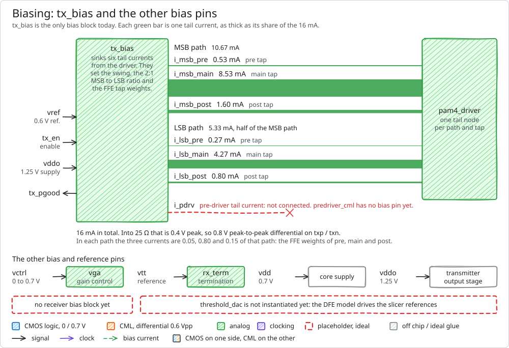

# Biasing

Every bias in the design starts at one reference and reaches its consumer on a wire of its own.

## Blocks

| Block | Owner | Purpose |
|---|---|---|
| [bias_ref](bias_ref.md) | Omar ElSawy | The reference: 0.6 V `vref`, and a 100 uA copy for each receiver-side bias block |
| [tx_bias](tx_bias.md) | Krrish Lala (from git history) | The six tail currents of the PAM4 driver, and one current for the pre-drivers |
| [tx_predrv_bias](tx_predrv_bias.md) | Omar ElSawy | Splits that one pre-driver current into six references, one per pre-driver |
| [rx_bias](rx_bias.md) | Omar ElSawy | `vtt`, `vctrl`, and a reference current for each receiver cell |
| [clk_bias](clk_bias.md) | Omar ElSawy | A reference current for each clocking cell |
| [threshold_dac](../Receiver/threshold_dac.md) | Justin Fang (from git history) | The 24 slicer references, one DAC per slicer, placed in [rx_decision](../Receiver/rx_decision.md) |

The new blocks are in `va/Biasing/`. `tx_bias` stays in `va/Transmitter/` and `threshold_dac` in `va/Receiver/Slicer/`.

## The rules every bias block follows

- **One bias wire, one consumer.** A block has one output per cell it feeds.
- **The consumer loads the wire.** A current input looks like a diode-connected mirror input, `vb_nom / ib_nom` ohms; here 0.35 V / 100 uA = 3.5 kohm.
- **The consumer checks its bias** and prints FAULT when it is more than 10 % off nominal.
- **Enable and a low supply fade the outputs** through a smooth gate, with a start-up time constant.
- **Supply current is drawn** from the supply pins, so the top-level power adds up.

## Bias wires

| Wire | From | To | Nominal |
|---|---|---|---|
| `vref` | bias_ref | tx_bias | 0.6 V |
| `iref_rx`, `iref_clk` | bias_ref | rx_bias, clk_bias | 100 uA each |
| six tail currents | tx_bias | pam4_driver | 16 mA in total |
| `i_pdrv` | tx_bias | tx_predrv_bias | 6 mA |
| `ib_pd[5:0]` | tx_predrv_bias | the six predriver_cml | 100 uA each |
| `vtt` | rx_bias | rx_term | 0.55 V |
| `vctrl` | rx_bias | vga | 0.35 V |
| `ib_ctle`, `ib_vga`, `ib_slicer[23:0]`, `ib_demux[11:0]` | rx_bias | top level | 100 uA each |
| twelve `ib_*` outputs | clk_bias | top level | 100 uA each |
| 24 references | threshold_dac x24 | the 24 slicers | `T + alpha * L`, within 2.6 mV |

The wires that end at the top level are for cells without a bias pin (`ctle`, `vga`, `slicer`, `demux2_cml` and the clocking cells). To connect one, its owner adds an `ib` input to the cell, loaded as above, and the wire is run down to it.

## Enables and supplies of the top level

| Pin | Value | What it does |
|---|---|---|
| `bias_en` | 1.25 V logic | Enables bias_ref and clk_bias |
| `tx_en` | 1.25 V logic | Enables tx_bias |
| `rx_en` | 0.7 V logic | Enables rx_bias |
| `vdd` | 0.7 V | Core supply; rx_bias and clk_bias run from it |
| `vddo` | 1.25 V | Output-stage supply; bias_ref, tx_bias and tx_predrv_bias run from it |
| `vss` | 0 V | Ground |

`tx_pgood` goes high once tx_bias is enabled and its supply has headroom.
