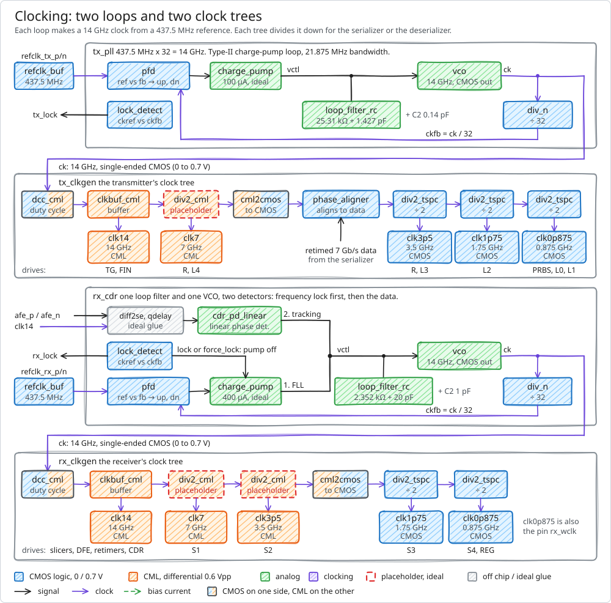

# Clocking

The Clocking section makes every clock in the chip. On the transmit side it multiplies the reference up to 14 GHz and divides that down for the serializer. On the receive side it recovers a 14 GHz clock from the incoming data and divides that down for the deserializer. The retiming flip-flops of the serializer are also kept here.

## How the clocks are made

Both sides start from an external 437.5 MHz reference, received by a [refclk_buf](refclk_buf.md).

### Transmitter side

1. [tx_pll](tx_pll.md) multiplies the reference by 32 to 14 GHz. It is a type-II charge-pump loop: [pfd](pfd.md), [charge_pump](charge_pump.md) (100 uA), [loop_filter_rc](loop_filter_rc.md) (R 25.31 kohm, C 1.427 pF, plus C2 0.14 pF), [vco](vco.md), [div_n](div_n.md) and [lock_detect](lock_detect.md). The loop bandwidth is 21.875 MHz.
2. [tx_clkgen](tx_clkgen.md) turns the 14 GHz into the clock tree: [dcc_cml](dcc_cml.md) (duty cycle) to [clkbuf_cml](clkbuf_cml.md) (`clk14`, CML) to [div2_cml](div2_cml.md) (`clk7`, CML) to [cml2cmos](cml2cmos.md) to [phase_aligner](phase_aligner.md) to three [div2_tspc](div2_tspc.md) (3.5, 1.75 and 0.875 GHz, CMOS).
3. The [phase_aligner](phase_aligner.md) is a small loop inside the tree. It locks the CMOS clocks to the retimed 7 Gb/s data, so the hand-off from CMOS-clocked to CML-clocked stages in the serializer is centred.

### Receiver side

1. [rx_cdr](rx_cdr.md) has one loop filter (R 2.352 kohm, C 20 pF, plus C2 1 pF) and one VCO, with two detectors. First a frequency loop, [pfd](pfd.md) and a 400 uA [charge_pump](charge_pump.md), compares the reference with the VCO divided by 32, until [lock_detect](lock_detect.md) asserts. Then [cdr_pd_linear](cdr_pd_linear.md), a linear phase detector, tracks the data at the output of the analog front end. The pin `force_lock` skips the frequency acquisition.
2. [rx_clkgen](rx_clkgen.md) turns the recovered 14 GHz into the clock tree: [dcc_cml](dcc_cml.md) to [clkbuf_cml](clkbuf_cml.md) (`clk14`, CML) to [div2_cml](div2_cml.md) (`clk7`) to [div2_cml](div2_cml.md) (`clk3p5`) to [cml2cmos](cml2cmos.md) to two [div2_tspc](div2_tspc.md) (1.75 and 0.875 GHz, CMOS).

In the present models the VCO output is a single-ended CMOS clock, 0 to 0.7 V. The `dcc_cml` at the head of each tree makes it differential.

### Which edge each divider uses

- `div2_cml` toggles on the rising edge of its input. The second one in `rx_clkgen` (7 to 3.5 GHz) has its input connected swapped, so it toggles on the falling edge of `clk7`.
- `div2_tspc` toggles on the falling edge of its input.

## The clocks

| Clock | Frequency | Type | Made by | Used by |
|---|---|---|---|---|
| TX `clk14` | 14 GHz | CML | `clkbuf_cml` | [ffe_tapgen_hr](../Transmitter/ffe_tapgen_hr.md), the three final [mux2_cml_hr](../Transmitter/mux2_cml_hr.md) |
| TX `clk7` | 7 GHz | CML | `div2_cml` | [cml_dff_x4](cml_dff_x4.md), the two level-L4 [mux2_cml_hr](../Transmitter/mux2_cml_hr.md) |
| TX `clk3p5`, `clk3p5b` | 3.5 GHz | CMOS | `div2_tspc` | [dff_tspc_x8](dff_tspc_x8.md), [mux2_cs](../Transmitter/mux2_cs.md) |
| TX `clk1p75` | 1.75 GHz | CMOS | `div2_tspc` | Level-L2 [mux2_cmos](../Transmitter/mux2_cmos.md) |
| TX `clk0p875` | 0.875 GHz | CMOS | `div2_tspc` | [prbs_gray_src](../Transmitter/prbs_gray_src.md), [dff_cmos_x32](dff_cmos_x32.md), level-L1 [mux2_cmos](../Transmitter/mux2_cmos.md) |
| RX `clk14` | 14 GHz | CML | `clkbuf_cml` | The 24 [slicer](../Receiver/slicer.md)s, [dfe1_unrolled_hr](../Receiver/dfe1_unrolled_hr.md), [rx_dec_retime](../Receiver/rx_dec_retime.md), [cdr_pd_linear](cdr_pd_linear.md) |
| RX `clk7` | 7 GHz | CML | `div2_cml` | First [demux2_cml](../Receiver/demux2_cml.md) stage |
| RX `clk3p5` | 3.5 GHz | CML | `div2_cml` | Second [demux2_cml](../Receiver/demux2_cml.md) stage |
| RX `clk1p75` | 1.75 GHz | CMOS | `div2_tspc` | First [demux2_cmos](../Receiver/demux2_cmos.md) stage |
| RX `clk0p875` | 0.875 GHz | CMOS | `div2_tspc` | Second [demux2_cmos](../Receiver/demux2_cmos.md) stage, output register; also the pin `rx_wclk` |

## Blocks

| Block | Kind | Owner (from git history) | Purpose |
|---|---|---|---|
| [refclk_buf](refclk_buf.md) | leaf | Ethan Sun (sunezh) | Receives the external 437.5 MHz differential reference and drives a rail-to-rail CMOS copy |
| [tx_pll](tx_pll.md) | structural | Ethan Sun (sunezh) | Transmitter PLL: multiplies the 437.5 MHz reference by 32 to 14 GHz |
| [pfd](pfd.md) | leaf | GreenBlueFish | Phase-frequency detector: says whether the reference or the divided clock is ahead |
| [charge_pump](charge_pump.md) | leaf, ideal | Ethan Sun (sunezh) | Ideal charge pump: turns the PFD's up / dn pulses into the loop-filter current |
| [loop_filter_rc](loop_filter_rc.md) | leaf | Sudhanshu Tiwari | Passive loop filter: a series R and C from the control node to ground |
| [vco](vco.md) | leaf | GreenBlueFish | Voltage-controlled oscillator: the 14 GHz clock source of the PLL and of the CDR |
| [div_n](div_n.md) | leaf | Ethan Sun (sunezh) | Feedback divider: divides the 14 GHz VCO clock by 32 down to the reference rate |
| [lock_detect](lock_detect.md) | leaf | Ethan Sun (sunezh) | Lock detector: raises `lock` when the reference and the divided clock stay aligned |
| [tx_clkgen](tx_clkgen.md) | structural | Ethan Sun (sunezh) | Transmitter clock tree: 14 GHz in; 14 and 7 GHz (CML) and 3.5, 1.75, 0.875 GHz (CMOS) out |
| [rx_clkgen](rx_clkgen.md) | structural | Ethan Sun (sunezh) | Receiver clock tree: 14 GHz in; 14, 7 and 3.5 GHz (CML) and 1.75, 0.875 GHz (CMOS) out |
| [dcc_cml](dcc_cml.md) | leaf | Sudhanshu Tiwari | Duty-cycle corrector: first cell of both clock trees, gives the 14 GHz clock a 50 % duty cycle |
| [clkbuf_cml](clkbuf_cml.md) | leaf | Ethan Sun (sunezh) | CML clock buffer: restores the swing of the 14 GHz clock and isolates its loads |
| [div2_cml](div2_cml.md) | placeholder | none yet | **Placeholder.** Ideal CML divide-by-2 for the 14 to 7 GHz and 7 to 3.5 GHz steps |
| [cml2cmos](cml2cmos.md) | leaf | Sudhanshu Tiwari | Converts a differential CML clock to a rail-to-rail single-ended CMOS clock |
| [phase_aligner](phase_aligner.md) | leaf | Winy | Small loop that shifts the 7 GHz CMOS clock so the CMOS clocks line up with the retimed 7 Gb/s data |
| [div2_tspc](div2_tspc.md) | leaf | Ethan Sun (sunezh) | CMOS (TSPC) divide-by-2: makes the 3.5, 1.75 and 0.875 GHz clocks |
| [rx_cdr](rx_cdr.md) | structural | Ethan Sun (sunezh) | Receiver clock and data recovery: a frequency loop first, then a phase detector that tracks the data |
| [cdr_pd_linear](cdr_pd_linear.md) | leaf | Winy | Linear phase detector of the CDR: compares the data with the 14 GHz clock and drives the loop filter |
| [glue](glue.md) | glue | Ethan Sun (sunezh) | Ideal wiring cells: `diff2se` (differential to single-ended), `qdelay` (quarter-period delay), `nor2` |
| [dff_cmos_x32](dff_cmos_x32.md) | leaf | Sudhanshu Tiwari | 32 CMOS flip-flops on one clock: retimes the 32-bit word at the serializer input |
| [dff_tspc_x8](dff_tspc_x8.md) | leaf | Ethan Sun (sunezh) | Eight TSPC flip-flops on one clock: retimes the eight 3.5 Gb/s lanes before the charge-steering muxes |
| [cml_dff_x4](cml_dff_x4.md) | leaf | Sudhanshu Tiwari | Four CML flip-flops on one clock: retimes the four 7 Gb/s lanes |

## Placeholders, ideal cells and gaps

- **[div2_cml](div2_cml.md) is a placeholder with no owner.** It is used three times. Someone needs to take it.
- **[charge_pump](charge_pump.md) is ideal.** Its header says the charge-pump circuit was scrapped from the design.
- **The [glue](glue.md) cells are ideal.** `diff2se`, `qdelay` and `nor2` stand in for wiring that the two detectors need and the surrounding blocks do not provide, including a quadrature clock for the CDR's phase detector.
- **The [vco](vco.md) has no coarse tuning** (no `band[3:0]` input) and a single-ended output.
- **[cml2cmos](cml2cmos.md) is ideal**: it has no delay.

## Conventions

- CMOS logic: single-ended, 0 / 0.7 V, threshold 0.35 V.
- CML: differential, each side 0.15 V around `vdd` - 0.15 V, so 0.6 V peak-to-peak differential.
- `rst` is active high.
- Jitter: several cells add random jitter to their output edges (`refclk_buf` 100 fs, `div_n` 150 fs, `clkbuf_cml` 40 fs, `div2_tspc` 300 fs, `dff_tspc_x8` 200 fs, all rms). The top-level parameter `rj_scale` scales all of them; 0 turns them off.
