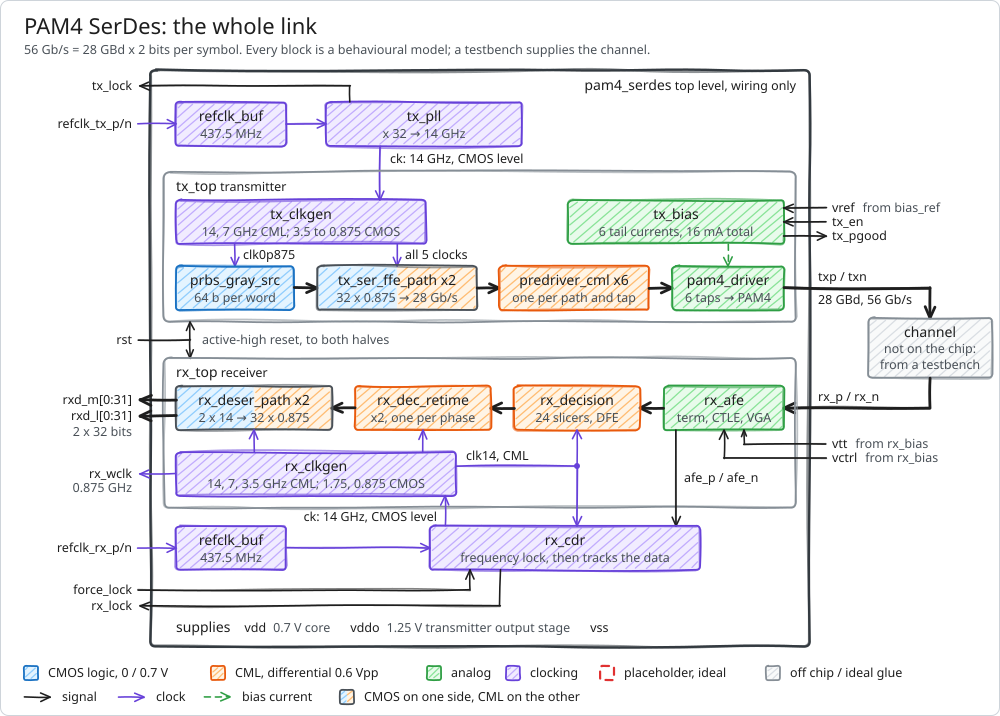

# PAM4 SerDes design documentation

This folder documents the design of a 56 Gb/s PAM4 serializer/deserializer (28 GBd, two bits per symbol), after Lee et al., JSSC 2015 ("56 Gb/s NRZ/PAM4"). A student team at UW ASIC is building it block by block. Every block has a behavioural Verilog-A model, written for a 0.7 V core supply (the models' comments say ASAP7), and the models are wired into one hierarchy that simulates. The next stage is **topology research** for every block (which circuit implements it), followed by **sizing research** (device sizes that meet the block's specs). Each block has one page here, and that page is where its research is written.



## The four sections

Each section overview has a diagram, the signal or clock flow, and a table of its blocks with links to their pages.

| Section | What it covers |
|---|---|
| [Biasing](Biasing/README.md) | Bias currents, reference voltages and supplies |
| [Clocking](Clocking/README.md) | The transmitter PLL, the receiver's clock recovery, both clock trees and the retiming flops |
| [Transmitter](Transmitter/README.md) | Data source, 32:1 serializer, FFE, pre-drivers and the PAM4 driver |
| [Receiver](Receiver/README.md) | Front end, slicers, DFE, decoders and the 1:32 deserializer |

## How a block's page is organised

Every block page has the same three sections, in the same order:

1. **Architecture.** What the block does, where it sits, its ports and parameters, and what the model leaves out. It is written from the Verilog-A model, which stays the source of truth. If you change the model, update this section.
2. **Topology research.** For the block's owner to fill in: the candidate circuits, the one that was chosen and why, a schematic, open questions and references. The requirements the model already states are listed, each with the file it comes from.
3. **Sizing research.** For the owner to fill in once the topology is chosen: target specs, the sizing method, the device table, simulation results against the targets, the corners checked and open issues.

Structural blocks are wiring only: their Topology and Sizing sections point to the pages of their cells. To write your research, edit your block's page (`analog/PAM4SerDes/docs/<Section>/<block>.md`) and commit it like any other file. Keep the three `##` headings as they are, because the README and the documentation site link to them.

Three kinds of block need attention before research can start:

- **Placeholders** ([div2_cml](Clocking/div2_cml.md), [mux2_cs](Transmitter/mux2_cs.md)) are ideal stand-ins with no owner. Someone needs to take each one.
- **Ideal cells** ([charge_pump](Clocking/charge_pump.md), the [glue](Clocking/glue.md) cells) stand for a circuit that was dropped or never drawn. Their pages say what to settle first.
- **Not placed** ([pam4_slicer](Receiver/pam4_slicer.md)): it has a model but is not in the hierarchy.

## Hierarchy

What instantiates what. A `*` marks an ideal placeholder. The channel between `txp` / `txn` and `rx_p` / `rx_n` is not part of the design; a testbench supplies it.

```
pam4_serdes                           va/pam4_serdes.va           top level
├─ bias_ref                           the reference: vref, and a current for each bias block
├─ rx_bias                            vtt, vctrl and the receiver's reference currents
├─ clk_bias                           the clocking cells' reference currents
├─ refclk_buf  x2                     reference clock receivers (one TX, one RX)
├─ tx_pll                             437.5 MHz x 32 = 14 GHz
│   └─ pfd, charge_pump, loop_filter_rc, vco, div_n, lock_detect
├─ tx_top                             complete transmitter
│   ├─ tx_clkgen                      14 GHz -> 14, 7 (CML) and 3.5, 1.75, 0.875 GHz (CMOS)
│   │   └─ dcc_cml, clkbuf_cml, div2_cml*, cml2cmos, phase_aligner, div2_tspc x3
│   ├─ diff2se                        ideal glue: feeds the phase_aligner
│   ├─ prbs_gray_src                  PRBS7 source, 64 bits per word clock, Gray coded
│   ├─ tx_ser_ffe_path  x2            32:1 serializer + FFE taps (MSB path and LSB path)
│   │   └─ dff_cmos_x32, mux2_cmos x24, dff_tspc_x8, mux2_cs* x4, cml_dff_x4,
│   │      mux2_cml_hr x5, ffe_tapgen_hr
│   ├─ predriver_cml  x6              one per path and FFE tap
│   ├─ pam4_driver                    sums the six taps into the PAM4 output
│   ├─ tx_bias                        the six driver tail currents (swing, 2:1, tap weights)
│   └─ tx_predrv_bias                 one bias wire per pre-driver
├─ rx_cdr                             clock recovery: FLL, then tracks the data
│   └─ pfd, charge_pump, loop_filter_rc, vco, div_n, lock_detect,
│      cdr_pd_linear, diff2se x2, qdelay, nor2   (last three: ideal glue)
└─ rx_top                             complete receiver datapath
    ├─ rx_afe
    │   └─ rx_term, ctle, vga
    ├─ rx_clkgen                      14 GHz -> 14, 7, 3.5 (CML) and 1.75, 0.875 GHz (CMOS)
    │   └─ dcc_cml, clkbuf_cml, div2_cml* x2, cml2cmos, div2_tspc x2
    ├─ rx_decision
    │   └─ slicer x24, threshold_dac x24, dfe1_unrolled_hr, pam4_dec x2
    ├─ rx_dec_retime  x2              one per sampling phase
    └─ rx_deser_path  x2              1:32 deserializer (MSB path and LSB path)
        └─ demux2_cml x6, demux2_cmos x24  (+ inline CML-to-CMOS and output register)

* = ideal placeholder; nobody has written the real block yet.
Not in the hierarchy: pam4_slicer (Receiver/Slicer/).
```

## The top level, `pam4_serdes`

The top level ([`va/pam4_serdes.va`](../va/pam4_serdes.va)) is wiring only. Its transmitter half and its receiver half share nothing but the supplies, the reference and `rst`. The transmitter's clock comes from `tx_pll` (437.5 MHz x 32 = 14 GHz). The receiver's clock comes from `rx_cdr`: a frequency loop against the reference, which then tracks the data at `rx_top`'s front end output. The receiver puts out 2 x 32 bits per `rx_wclk` cycle.

### Pins

| Pin | Direction | Carries |
|---|---|---|
| `refclk_tx_p`, `refclk_tx_n` | input | 437.5 MHz differential reference for the transmitter |
| `refclk_rx_p`, `refclk_rx_n` | input | 437.5 MHz differential reference for the receiver |
| `rst` | input | Reset, active high |
| `bias_en` | input | Enable of the reference and the clocking bias, 1.25 V logic |
| `tx_en` | input | Enable of the transmitter bias, 1.25 V logic |
| `rx_en` | input | Enable of the receiver bias, 0.7 V logic |
| `txp`, `txn` | output | Transmitter output pads, PAM4 |
| `tx_lock` | output | Transmitter PLL is locked |
| `tx_pgood` | output | Transmitter bias is up |
| `rx_p`, `rx_n` | inout | Receiver input pads |
| `force_lock` | input | High skips the receiver's frequency acquisition |
| `rxd_m[0:31]`, `rxd_l[0:31]` | output | Received MSB word and LSB word |
| `rx_wclk` | output | Receiver word clock, 0.875 GHz |
| `rx_lock` | output | Receiver frequency loop is locked |
| `vdd` | inout | 0.7 V core supply |
| `vddo` | inout | 1.25 V supply of the transmitter's output stage |
| `vss` | inout | Ground |

### Parameters

| Parameter | Default | Meaning |
|---|---|---|
| `w_pre`, `w_main`, `w_post` | 0.05, 0.80, 0.15 | FFE tap weights; pre and post are applied negative |
| `main_boost_db` | 0 dB | CTLE main peaking boost |
| `alpha` | 0.08548 | DFE tap: first post-cursor / main cursor |
| `rj_scale` | 1 | Scale of the added jitter of the clocking cells: 1 = defaults, 0 = none |

## Conventions used in the models

- CMOS logic: single-ended, 0 / 0.7 V, threshold 0.35 V.
- CML: differential, each side 0.15 V around `vdd` - 0.15 V, so 0.6 V peak-to-peak differential.
- `rst` is active high everywhere.
- Lane order: wire j of a 32-bit word carries time slot j, and slot 0 is sent (or was received) first.

## Changes, owners and simulating

- Changes: [CHANGELOGS.md](../../../CHANGELOGS.md), at the repo root, says what integration changed in each person's work, and how the top level is put together.
- Owners: the "Owner (from git history)" on each page is the author of the model file in the git history. Where a lead committed a file for someone else, the real author is shown. **If an owner is wrong, correct it** on the block's page, in the section overview and in the table of the repo's [README](../../../README.md).
- Simulating: how to build, run and check the hierarchy is in the repo's [README](../../../README.md#check-the-design). Test decks are in `analog/PAM4SerDes/test/`.
