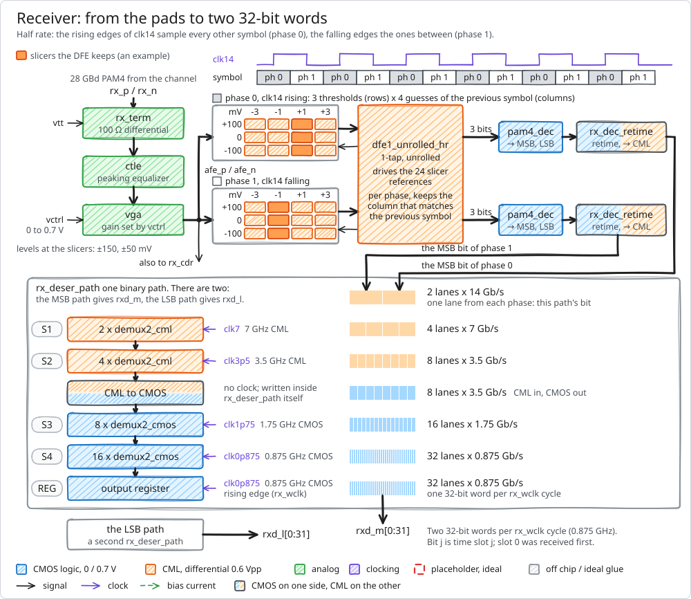

# Receiver

The Receiver section takes the PAM4 signal from the line and turns it back into bits: it terminates and equalizes the signal, slices it, removes the echo of the previous symbol, decodes the symbols and deserializes them 1:32.

## How the signal moves through it

1. **Front end**, [rx_afe](rx_afe.md): `rx_p` / `rx_n` to [rx_term](rx_term.md) (100 ohm differential, ESD capacitance) to [ctle](ctle.md) (peaking equalizer) to [vga](vga.md) (variable gain, control voltage `vctrl`).
2. **Slicing**: the front end's output goes to 24 [slicer](slicer.md)s inside [rx_decision](rx_decision.md).
3. **DFE**: [dfe1_unrolled_hr](dfe1_unrolled_hr.md), a one-tap unrolled decision feedback equalizer, drives the 24 slicer references and, per phase, picks the 3 slicer outputs whose hypothesis matches the previous symbol. Its output is a 3-bit thermometer code per phase.
4. **Decoding**: one [pam4_dec](pam4_dec.md) per phase turns the thermometer code into 2 bits (MSB, LSB), Gray decoded.
5. **Retiming**: one [rx_dec_retime](rx_dec_retime.md) per phase.
6. **Deserializing**: one [rx_deser_path](rx_deser_path.md) per binary path: 2 x 14 Gb/s to 4 x 7 to 8 x 3.5 ([demux2_cml](demux2_cml.md)), then CML to CMOS, then 16 x 1.75 to 32 x 0.875 Gb/s ([demux2_cmos](demux2_cmos.md)), then an output register.

### Why 24 slicers

24 = 3 thresholds x 4 DFE hypotheses x 2 sampling phases.

- Three thresholds separate the four PAM4 levels.
- The DFE is unrolled: for each of the four values the previous symbol could have had, there is a set of slicers with thresholds already shifted for that case.
- The receiver is half-rate. Phase 0 samples on `clk14` rising and phase 1 on `clk14` falling, so each phase runs at 14 GBd.

### Levels

The levels expected at the slicers are plus or minus 150 mV and plus or minus 50 mV. The thresholds are -100, 0 and +100 mV.

### Output

`rxd_m[0:31]` and `rxd_l[0:31]`: two 32-bit words per cycle of `rx_wclk` (0.875 GHz). Index j is time slot j, and slot 0 was received first. The exact timing rules for the two phases and for reading the words are on the [rx_top](rx_top.md) page.

## Blocks

| Block | Kind | Owner (from git history) | Purpose |
|---|---|---|---|
| [rx_top](rx_top.md) | structural | Omar El-Sawy (integration) | The complete receiver datapath: front end, clock tree, decision stage, retimers and two deserializer paths |
| [rx_afe](rx_afe.md) | structural | Ethan Sun (sunezh) | Analog front end: termination, CTLE and VGA in a row |
| [rx_term](rx_term.md) | leaf | Mehak Khan | Input termination: 100 ohm differential and the ESD capacitance of the pads |
| [ctle](ctle.md) | leaf | Kayhan Baig | Continuous-time linear equalizer: boosts high frequencies to undo channel loss |
| [vga](vga.md) | leaf | Mehak Khan | Variable-gain amplifier: sets the signal amplitude at the slicers |
| [rx_decision](rx_decision.md) | structural | Mehak Khan | Decision stage: 24 slicers, the one-tap unrolled DFE and one PAM4 decoder per phase |
| [slicer](slicer.md) | leaf | Justin Fang | Clocked comparator: decides whether the signal is above or below one threshold |
| [threshold_dac](threshold_dac.md) | leaf, not instantiated | Justin Fang | 6-bit DAC that makes one slicer threshold. **Not instantiated yet**: the DFE model drives the thresholds |
| [pam4_slicer](pam4_slicer.md) | structural, not instantiated | Justin Fang | Three slicers with three threshold DACs: a plain PAM4 slicer with no DFE. **Not instantiated** |
| [dfe1_unrolled_hr](dfe1_unrolled_hr.md) | leaf | deaconsham | One-tap unrolled DFE, half rate: drives the 24 slicer references and picks the right 3 decisions per phase |
| [pam4_dec](pam4_dec.md) | leaf | Kayhan Baig | Thermometer-to-Gray decoder: turns three slicer decisions into the two bits of a PAM4 symbol |
| [rx_dec_retime](rx_dec_retime.md) | leaf | Mehak Khan | Retimes one phase's two decoded bits on the 14 GHz clock and puts them out as CML |
| [rx_deser_path](rx_deser_path.md) | structural | Mehak Khan | One binary path's 1:32 deserializer: two 14 Gb/s streams in, a 32-bit word at 0.875 GHz out |
| [demux2_cml](demux2_cml.md) | leaf | deaconsham | CML 1:2 demultiplexer for the two fastest deserializer stages |
| [demux2_cmos](demux2_cmos.md) | leaf | deaconsham | CMOS 1:2 demultiplexer for the two slowest deserializer stages |

The receiver's clock tree, [rx_clkgen](../Clocking/rx_clkgen.md), and its clock recovery, [rx_cdr](../Clocking/rx_cdr.md), are documented in the Clocking section.

## Not instantiated, and gaps

- **[threshold_dac](threshold_dac.md) is not instantiated.** The DFE model drives the slicer references itself, as ideal voltages.
- **[pam4_slicer](pam4_slicer.md) is not instantiated.** It is a plain three-slicer PAM4 slicer with no DFE; [rx_decision](rx_decision.md) instantiates its 24 slicers directly.
- **The gain and boost codes are not modelled.** The VGA gain is set by the analog voltage `vctrl`, not by its `g[5:0]` code, and a number in dB stands in for the CTLE's `bst[3:0]` code.
- **Two pieces of [rx_deser_path](rx_deser_path.md) are written inline** and have no cell of their own: the CML-to-CMOS conversion and the output register.
- **There is no receiver bias block** (see the Biasing section).
- The channel in front of `rx_p` / `rx_n` is not part of the design; a testbench supplies it.

## Conventions

- CMOS logic: single-ended, 0 / 0.7 V, threshold 0.35 V.
- CML: differential, each side 0.15 V around `vdd` - 0.15 V, so 0.6 V peak-to-peak differential.
- `rst` is active high.
