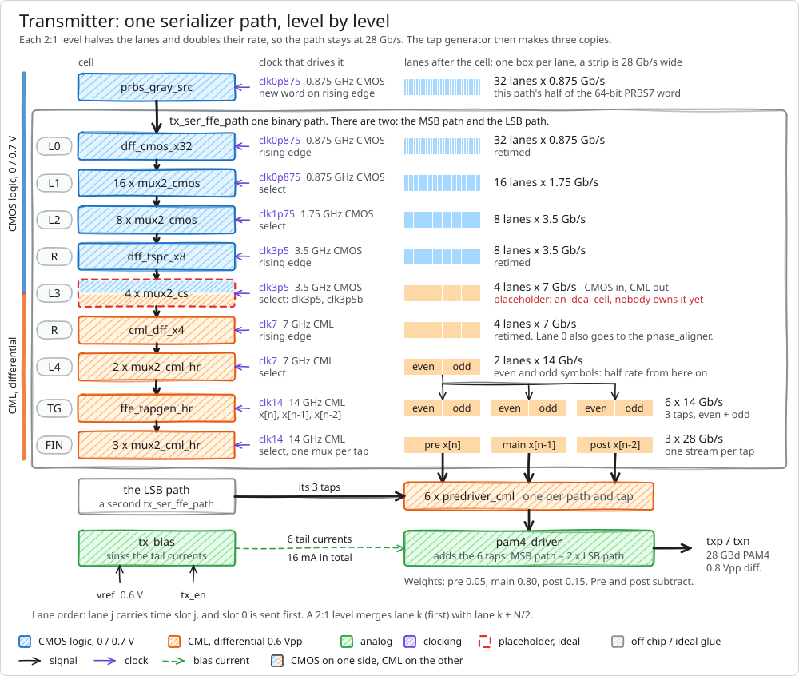

# Transmitter

Takes parallel data and sends it as a 28 GBd PAM4 signal: data source, 32:1 serializer, three-tap feed-forward equalizer (FFE), line driver.

## Signal flow

A PAM4 symbol carries two bits, so there are two identical binary paths, MSB and LSB, added at the driver with weights 2 : 1.

1. [prbs_gray_src](prbs_gray_src.md) makes a PRBS7 pattern: 64 bits (32 Gray-coded symbols) per cycle of the 0.875 GHz word clock.
2. [tx_top](tx_top.md) gives the MSB of every symbol to one [tx_ser_ffe_path](tx_ser_ffe_path.md) and the LSB to the other.
3. Each path serializes its 32 bits to 28 Gb/s and makes three copies one unit interval apart, the FFE taps. The level-by-level table is on the [tx_ser_ffe_path](tx_ser_ffe_path.md) page.
4. Six [predriver_cml](predriver_cml.md), one per path and tap, pass the taps to [pam4_driver](pam4_driver.md), which sums them. [tx_bias](../Biasing/tx_bias.md) sets how much each tap contributes.

- Rates per path: 32 x 0.875 = 16 x 1.75 = 8 x 3.5 = 4 x 7 = 2 x 14 = 1 x 28 Gb/s.
- FFE: three taps made at half rate, x[n] (pre), x[n-1] (main) and x[n-2] (post), weights 0.05, 0.80 and 0.15; pre and post are subtracted.
- PAM4: the MSB path carries twice the current of the LSB path, which gives the levels -3, -1, +1, +3. The PRBS bits of a symbol (`hi`, `lo`) go out as MSB = `hi` and LSB = `hi` XOR `lo`, so going up the levels the PRBS bits read 00, 01, 11, 10.
- Swing: `tx_bias` sinks 16 mA in total from the driver's six tail nodes, MSB : LSB = 10.67 mA : 5.33 mA. Into 25 ohm that is 0.4 V peak, 0.8 V peak-to-peak differential.
- Lane order: wire j of a path's 32-bit word carries time slot j, and slot 0 is sent first.

## Blocks

| Block | Kind | Owner (from git history) | Purpose |
|---|---|---|---|
| [tx_top](tx_top.md) | structural | Omar ElSawy (integration) | The complete transmitter: clock tree, data source, two serializer paths, pre-drivers, driver and bias |
| [tx_ser_ffe_path](tx_ser_ffe_path.md) | structural | Omar ElSawy (integration) | One binary path: 32:1 serializer and the three half-rate FFE taps |
| [prbs_gray_src](prbs_gray_src.md) | leaf | oDNA | Test data source: PRBS7, 64 bits (32 Gray-coded symbols) per word clock |
| [mux2_cmos](mux2_cmos.md) | leaf | oDNA | CMOS 2:1 multiplexer for the two slowest serializer levels |
| [mux2_cs](mux2_cs.md) | placeholder | none yet | **Placeholder.** Ideal charge-steering 2:1 multiplexer: 3.5 to 7 Gb/s, CMOS in, CML out |
| [mux2_cml_hr](mux2_cml_hr.md) | leaf | hdsouza13 | CML 2:1 multiplexer for the two fastest steps: 7 to 14 Gb/s and 14 to 28 Gb/s |
| [ffe_tapgen_hr](ffe_tapgen_hr.md) | leaf | hdsouza13 | Half-rate FFE tap generator: makes the pre, main and post taps from the even and odd 14 Gb/s streams |
| [predriver_cml](predriver_cml.md) | leaf | Zoey Situ | Buffer between each 28 Gb/s tap and the output driver |
| [pam4_driver](pam4_driver.md) | leaf | Zoey Situ | Output stage: sums the six FFE taps into the differential PAM4 signal on the pads |

Documented in other sections: the clock tree [tx_clkgen](../Clocking/tx_clkgen.md) and the retiming flops [dff_cmos_x32](../Clocking/dff_cmos_x32.md), [dff_tspc_x8](../Clocking/dff_tspc_x8.md) and [cml_dff_x4](../Clocking/cml_dff_x4.md) in Clocking; [tx_bias](../Biasing/tx_bias.md) and `tx_predrv_bias` in [Biasing](../Biasing/README.md).

## Gaps and conventions

- [mux2_cs](mux2_cs.md) is a placeholder with no owner: the charge-steering multiplexer of level L3, four per path. Someone needs to take it.
- There is no data input. The only source is the PRBS generator.
- The channel behind `txp` / `txn` is not part of the design; a testbench supplies it.
- CMOS logic: single-ended, 0 / 0.7 V, threshold 0.35 V.
- CML: differential, each side 0.15 V around `vdd` - 0.15 V, so 0.6 V peak-to-peak differential.
- `vdd` is the 0.7 V core supply; `vddo` is the 1.25 V supply of the output stage. `rst` is active high.
